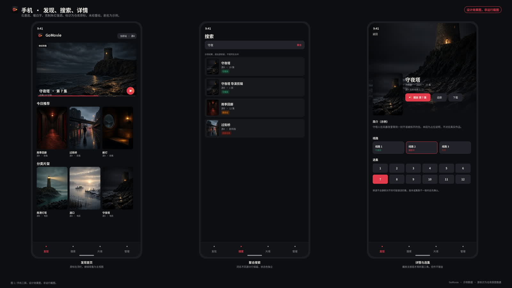
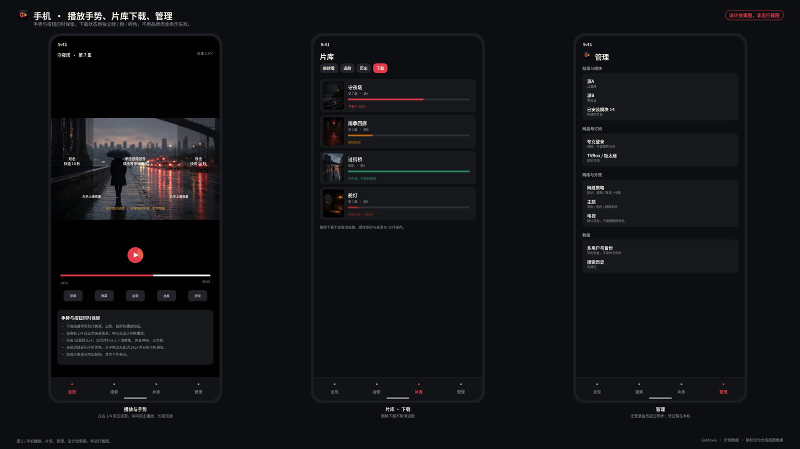
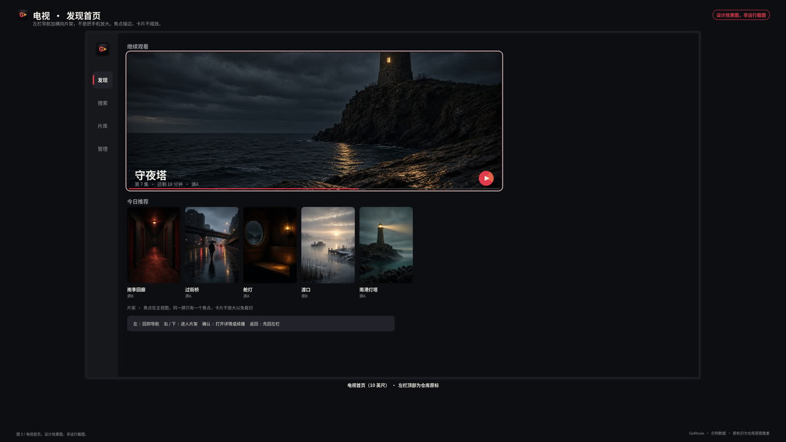
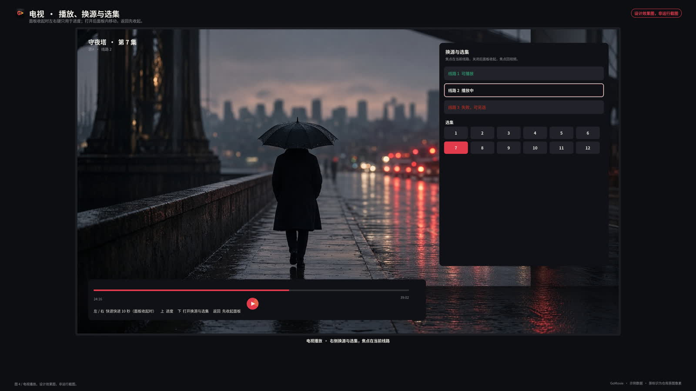
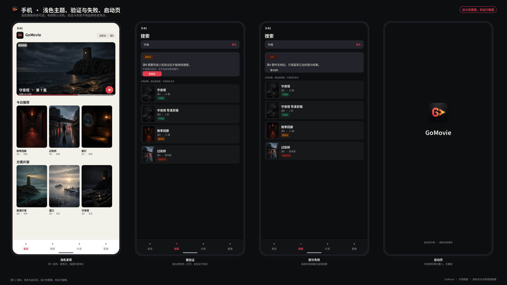

# GoMovie 体验重构规格

本文是手机与电视并列的现行重构规格，供研发对照和验收。品牌名仍是 **GoMovie**。标识继续使用仓库里的赤金折纸 G 加播放箭头，母版是 [`scripts/brand_icon_master.png`](../../scripts/brand_icon_master.png) 与 [`scripts/brand_icon.svg`](../../scripts/brand_icon.svg)。标识像素不重绘、不替换。

本文写的是设计目标。实现进度、已经跑过的证据和还没做的事见 [实现状态与证据](status.md)。可勾选的验收项见 [验收清单](acceptance.md)。

废弃决定只记一笔：青绿「灯廊 / 灯隙」和 Logo A/B 新标不再使用。对比图不收入本文。

## 阅读范围

- 剧名、集数、线路状态、海报都是设计示例，不是站源内容，也不是运行截图。
- 效果图来自设计稿，已按宽度 1600 压缩，放在 [`boards/`](boards/)。
- 没有代码依据的登录、会员、收费、云同步不在范围内。
- 不把本地继续看或站源榜单写成服务端「猜你喜欢」。

## 效果图

| 图 | 文件 | 内容 |
| --- | --- | --- |
| 图 1 | [boards/board-01-phone-discover-search-detail.jpg](boards/board-01-phone-discover-search-detail.jpg) | 手机发现、聚合搜索、详情与选集 |
| 图 2 | [boards/board-02-phone-player-library-manage.jpg](boards/board-02-phone-player-library-manage.jpg) | 手机播放与手势、片库下载、管理 |
| 图 3 | [boards/board-03-tv-home.jpg](boards/board-03-tv-home.jpg) | 电视首页，左栏加横向片架，焦点不放大 |
| 图 4 | [boards/board-04-tv-player.jpg](boards/board-04-tv-player.jpg) | 电视播放时的换源与选集 |
| 图 5 | [boards/board-05-phone-light-states-splash.jpg](boards/board-05-phone-light-states-splash.jpg) | 浅色发现、需验证、部分失败、启动页原标 |

## 产品目标

手机和电视并列优先。桌面沿用左栏加键鼠，不单独做桌面高保真，也不把这次做成桌面优先。

保留现有能力：JS 站源模块、跨源搜索、TVBox / 饭太硬、夸克扫码、播放选集换源、追剧历史、离线下载、弹幕、人机验证、按站网络策略、电视字母键盘、本地多用户与备份、已有端的画中画、投屏入口、后台播放开关、硬解与画面比例。

Flutter 只负责展示和导航壳。`LocalStore`、`PlaybackSession`、追剧与下载仍是各自的写入主人。手机壳和电视壳可以共享业务对象，不共享焦点逻辑。同一时刻只有一个播放会话主人。历史、收藏、下载和站源配置的迁移不能丢数据，也不改 `LocalStore` 的既有快照结构。

## 功能保留映射

标记：保留、重构入口、重构导航、待核、新增建议。待核项没有实机或代码闭环之前，不能写成已支持。

| 能力 | 代码依据 | 设计处理 | 标记 |
| --- | --- | --- | --- |
| JS 站源模块 | `modules/`，构建时嵌入 | 留在管理，可装卸开关 | 保留 |
| 跨源搜索 | `lib/ui/search/search_page.dart` | 升为一级。按站源加 ID 分行，不按同名合并。聚合只拉各站第 1 页，最多 6 路，排除夸克 | 重构入口 |
| TVBox / 饭太硬 | `netdisk_page.dart`，`native/core/app_tvbox.go` | 管理里的网盘与订阅 | 保留 |
| 夸克网盘 | 扫码登录，Cookie 留在本机 | 保留扫码。凭证不写日志、不进明文偏好 | 保留 |
| 播放 / 选集 / 换源 | `playback_session.dart` 与两端播放器 | 换源做成双端播放器里的明确面板。异版本不静默错集 | 重构入口 |
| 追剧 / 历史 | `follow_page.dart`，`history_page.dart` | 归入片库分段。历史开关只隐藏分段，不删记录 | 重构导航 |
| 离线下载 | `downloads/` | 手机保留。电视不把复杂编辑当主界面，也不删能力 | 电视限制待核 |
| 弹幕 | `danmaku_overlay.dart`，`PlaybackPreferences` | 开关、透明度、密度、速度、区域、屏蔽词保留。失败只关弹幕，不影响视频 | 保留 |
| 人机验证 | `webview_bridge.dart` | 结果和线路直接写「需验证」，不绕过 | 保留 |
| 按站网络策略 | 资源设置 | 管理页可见。电视用菜单键或二次确认，不靠长按 | 入口待核 |
| 电视字母键盘 | `letter_keyboard.dart` | 保留，可关 | 保留 |
| 多用户与备份 | `lib/ui/users/`，`backup_actions.dart` | 归入管理。本地导出恢复，不是云同步 | 保留 |
| 画中画 | `picture_in_picture.dart` | 保留已有端。iOS PiP 不保证 | 平台差异 |
| 投屏 | `cast_page.dart` | 保留入口。机型兼容待实机 | 待核 |
| 后台播放 | `backgroundPlayback`，默认关 | 保留开关。来电和音频焦点待实机 | 保留 |
| 硬解 / 画面比例 | `TelevisionDecoder`，`VideoFit` | 保留为设置 | 保留 |
| 字幕 / 音轨 | 播放会话里有音轨选择调用 | 字幕界面是否完整待核，不写成已可选 | 待核 |
| 片头片尾跳过 | 偏好里没有对应项 | 不声称已有 | 新增建议 |
| 完播连播 | `autoAdvance`，完播回调 | 必须尊重用户开关 | 重构 |
| 扫码投递网盘链接 | 无现成协议 | 可以后做。不绕过验证码 | 新增建议 |

`sorani_account_view` 是青空账号登录，不是会员体系。

## 信息架构

一级从「发现 / 追剧 / 历史 / 我的」改为四个共享目的。只换壳。

| 一级 | 承载 | 手机 | 电视 |
| --- | --- | --- | --- |
| 发现 | 有目录的站源浏览、继续观看、分类与榜单、粘贴网盘链接 | 底栏 | 左栏加主视图加横向片架 |
| 搜索 | 默认跨源聚合，可切回当前站。最近搜索可清空 | 底栏加输入 | 左栏加字母键盘 |
| 片库 | 继续看、追剧、历史。手机含下载状态 | 底栏加分段 | 左栏加横向分组 |
| 管理 | 站源摘要、模块、网盘订阅、网络、外观、用户与备份 | 底栏加分组 | 左栏加大目标 |

发现首页的默认站源必须是能出目录的非成人站。没有发现目录的通道（例如「网盘分享」，只接受粘贴链接）可以保留，但不能冒充推荐首页。空状态要分开写：

- 这个站源没有发现目录。
- 还没有选择或安装站源。
- 请求失败，已有结果保留。
- 这个分类加载完成后确实没有内容。

不要用假剧填生产列表。

其它已有页继续存在：详情、竖屏和横屏播放器、投屏、弹幕设置、多用户锁、开屏模糊封面。完整首启隐私协议页本轮没有独立流程，不编造。

## 页面要点

### 发现

宽幅主视觉，标题和进度叠在海报下缘，主播放键用折面渐变。其下是今日推荐和分类片架。推荐来自当前站源模块和本地继续看。电视焦点是描边，不放大到裁切。

### 搜索

输入框旁可切「聚合 / 本站」。提示写明按站源保留、同名不合并。行上展示封面、标题、站源和集数。状态只用已知事实：需验证、线路失败、部分失败。没有播放能力探测时，不给每行贴「可播放」。

部分失败保留其它站已经返回的结果，重试只打失败的站。验证走现有 WebView，不自动换源绕过。

### 详情

海报、标题、红底主播放、追剧、下载、简介、线路、选集。线路集数不一致时，文案说明不会自动跳集，用户点中的集才播放。

### 播放

手机控件和手势并存，按钮不拿隐藏手势代替。底栏至少有锁屏、弹幕、换源、选集、倍速。进度用品牌朱红。倍速徽章在长按时可见，松手恢复。

电视播放收起控件时：左/右快进退 10 秒，上打开进度，下打开线路与选集，确认播放或暂停。面板打开后方向键留在面板里，返回先关面板，焦点回视频。

### 片库

分段：继续看、追剧、历史、下载。继续看用真实进度。下载用独立颜色加文字表示进行中、等待、完成、失败。删除下载不取消追剧。

### 管理

首页是分组摘要，不把每个站源铺成一长列把网盘、主题和备份挤出首屏。

- 站源与模块：一行摘要（已启用数量、其中可发现数量），点进站源页再看每个站的能力和开关。模块装卸仍走原页面。
- 网盘与订阅：夸克扫码、TVBox / 饭太硬。
- 网络与外观：按站策略、深浅色、电视显示模式。
- 数据：多用户、本地备份、搜索历史可清空。

### 启动页

静态原标识和「GoMovie」。不做阻塞启动的大动画。

## 视觉系统

色值从原标收敛，不走高饱和 Material 种子把整套控件染成亮金。

| 角色 | 深色 | 浅色 |
| --- | --- | --- |
| 画布 | `#0D0E12` | `#F6F1E8` |
| 表层 | `#17181C` | `#FFFBF6` |
| 抬升 | `#22232A` | `#E7E1D6` |
| 正文 | `#F4F1EA` | `#1C1B19` |
| 次要文字 | `#9A9AA3` | `#6F6A63` |
| 品牌朱红 | `#E23B4C` | 同左 |
| 琥珀 | `#E8A63A` | 只用于原标高光和主播放键折面 |

状态色必须带文字：

| 状态 | 深色底上的色 | 用途 |
| --- | --- | --- |
| 成功 | `#2C8A64` | 可播放、已完成 |
| 警告 | `#C26B16` | 需验证、等待、存储不足 |
| 错误 | `#9E2B22` | 失败。比品牌朱红更暗 |

正文与底的对比目标至少 4.5:1。状态不单靠颜色。

主题：

- 手机：深色、浅色、跟随系统。可在管理里覆盖。
- 电视：默认深色，不跟壁纸取色。
- 纯黑模式若已有开关，继续保留，不取代这套石墨层级。

金属折面只用于原 Logo 和主播放键。其它按钮是平面朱红或中性表面。

字号与间距：

- 手机正文约 15–17，标题约 22–28。页边距 20。可点目标至少 44。底栏避开系统指示条。
- 电视 1080p 正文不宜小于 24 CSS 像素的阅读尺度；主视图剧名更大。片架间距约 24–32。焦点框离素材至少 8。
- 海报竖图约 2:3，主视觉用宽幅。圆角约 16–22。

原标用法：系统图标直角全出血，由系统裁切。启动页用原图。电视和侧栏是同一枚标加字标 GoMovie。导航角标只用这一枚，不另画。

## 交互

### 手机返回

系统返回先关当前页或面板。已经在发现根页时，再按一次才退出。其它一级页的返回回到发现。

### 手机手势

和按钮并存。规则全应用一致，并写在播放设置里。

| 手势 | 规则 |
| --- | --- |
| 单击画面 | 切换控件显隐。暂停时控件保持 |
| 双击左 / 右各 1/4 | 快退 / 快进 10 秒。连击累加 |
| 双击中间 | 只切换播放 / 暂停 |
| 关闭双击快进后 | 双击一律切换播放 |
| 水平拖动 | seek。跨度不超过片长，也不超过 120 秒。距左右边缘 24pt 内让给系统返回 |
| 左半垂直 | 亮度 |
| 右半垂直 | 音量 |
| 上下滑换集 | 与亮度音量互斥。设置里写明。亮度音量开着时，不启用换集滑动 |
| 长按 | 临时倍速，松手恢复，并显示徽章 |
| 锁屏 | 单击只唤出解锁。其它手势关闭 |
| 选集或换源面板打开 | 不再用画面滑动 seek |

### 电视返回与焦点

首页和片架：上到顶再上进入主视图；下到下一行；片架第一张再左回左栏；确认打开详情或续播。返回先回左栏，已经在左栏再按则在短时间里再按一次退出。

播放且面板收起：左/右 10 秒，上进度条，下打开换源选集并落在当前项，确认播放或暂停，返回退出播放。

播放且面板打开：方向键只在面板内移动，确认选定线路或集，返回先关面板并把焦点交回视频。

同一屏幕只有一个焦点。暖白约 3px 描边，可加弱朱红内缘。不缩放卡片。边界不丢焦点。不依赖长按。

### 动效

尊重系统「减少动效」。减少动效时转场时长为 0。

| 场景 | 时长 | 说明 |
| --- | --- | --- |
| 页面转场 | 280–320ms | 不能挡住首屏 |
| 底栏指示 | 约 220ms | 圆点或短条，不弹跳 |
| 电视焦点 | 约 180ms | 只移动描边 |
| 播放控件 | 约 180ms | 暂停时可以立刻可见 |
| 换源 / 选集弹层 | 220–280ms | 返回立刻可关 |
| 骨架屏 | 慢速微光 | 禁止大面积闪烁 |
| 启动 | 无阻塞动画 | 静态原标 |

## 播放状态

`PlaybackSession` 是唯一会话主人。`play()` 用代际作废旧请求。退出时保存进度并释放播放器和站源 session。

| 状态 | 界面 | 允许的动作 |
| --- | --- | --- |
| 待解析 | 文案「正在准备播放」 | 返回、取消 |
| 重新取址 / 备用线路 | 对应文案 | 返回 |
| 需验证 | 「需验证」和去验证 | 去验证、换源、取消。不自动跳过 |
| 缓冲 | 短暂后再出缓冲指示 | 暂停、返回 |
| 播放 | 触控下控件数秒后隐藏 | 手势和按钮 |
| 暂停 | 控件保持 | 播放、seek、换源 |
| seek | 中间时间徽章 | 松手落点。边缘 24pt 不抢系统返回 |
| 换集 / 换源 | 旧会话释放 | 集数或剪辑版本不一致时先确认 |
| 结束 | 打开连播且有下一集才进入下一集，否则停住 | 重播、返回 |
| 失败 | 说明症状 | 重试、换集、换线路。恢复用尽后停住，不自动死循环换源 |
| 退出 | 先保存进度 | 释放播放器 |

完播连播读取 `autoAdvance`。保存倍速等其它偏好时，不得把这个开关写回打开。

## 数据、异常与隐私

搜索提交立即开始。联想输入防抖约 250ms。新的一代请求使旧响应无效。

单站失败记入该站，不清空其它站。设计上的单站超时建议是 15 秒；Go 层是否已经统一超时仍待核，文档不把它写成已测量的事实。

下载：媒体身份和来源 ID 分开。删除下载要确认，且不取消追剧。存储不足、断网、权限不足要给出具体动作，而不是只变色。

凭证留在本机安全存储。不做隐私遥测。若以后要加，必须默认关。

无障碍：读屏能读出选中的一级页、锁屏和线路状态。动态字体下目标不被裁成不可读。电视远距下字号和焦点框留出边，不靠放大卡片。

## 架构边界

推荐做法是渐进改 Flutter 展示层。

- 展示和导航在 Flutter。
- 应用状态仍由 `LocalStore`、`PlaybackSession`、追剧与下载对象拥有。
- 仓储经 `NativeRepository` 访问 Go。
- 代际取消、恢复和解析不随 UI 重写。
- 站源模块契约不变。

不推荐把 UI 和播放会话一起推倒。

## 构建与签名

正式覆盖安装仍走仓库已有的手动工作流 `.github/workflows/build.yml`。它只在 `workflow_dispatch` 时运行，并使用仓库 Secrets 里的签名配置。本文不记录密钥，也不改 keystore。

没有发布密钥时打出的包是 Android Debug 签名。它不能覆盖已经用正式证书安装的 GoMovie。验收机器可以装调试包，不要要求用户卸载正式包或清空数据。

iOS 需要 macOS、Xcode 和合法签名配置。未签名 IPA 不能直接安装到 iPhone。Linux 构建机不能完成这一步。

## 分篇

- [实现状态与证据](status.md)
- [验收清单](acceptance.md)
